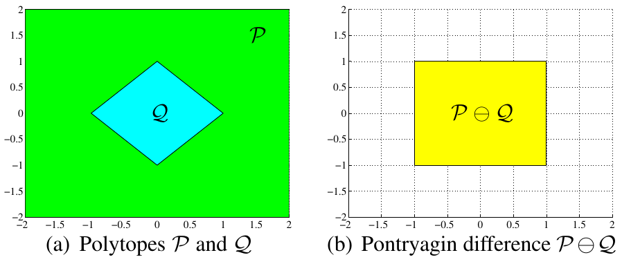
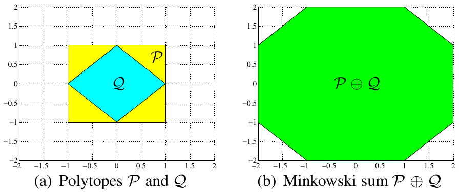

# hpolytope-cpp

## Overview

hpolytope-cpp is a C++20 library for convex polytopes described by linear
inequalities $Ax \le b$. It was written primarily with robust model predictive control (MPC) application in mind, so the features available are those needed in this kind of controller.

The API covers intersection, Minkowski sum, Pontryagin difference, linear maps
and preimages, as well as containment, emptiness, support functions, vertex
enumeration, and removal of redundant inequalities. 

Eigen handles the matrix
operations, and cddlib provides linear programming and the double-description
method.

## Requirements

- C++20 compiler, CMake 3.20 or later.
- Eigen 3 and cddlib.
- GoogleTest for the test suite (enabled by default).

## Installation

Install the build and test dependencies on Ubuntu 24.04, then build from the
repository root.

```sh
sudo apt update
sudo apt install g++ cmake make pkg-config libcdd-dev libeigen3-dev libgtest-dev
cmake -S . -B build
cmake --build build
```

## Usage

With the repository at `external/hpolytope-cpp`, link the library to your
application in its `CMakeLists.txt`.

```cmake
add_subdirectory(external/hpolytope-cpp)
add_executable(example main.cpp)
target_link_libraries(example PRIVATE hpolytope::hpolytope)
```

### Examples

Both examples use the diamond $Q = \{ (x, y) : |x| + |y| \le 1 \}$ from
Figures 7 and 8 of [1]. Each row of a matrix below gives one inequality.

```cpp
#include <Eigen/Dense>
#include <hpolytope-cpp/hpolytope.hpp>

int main() {
    using hpolytope::HPolytope;

    Eigen::Matrix<double, 4, 2> axes, diagonals;
    axes << 1, 0, -1, 0, 0, 1, 0, -1;
    diagonals << 1, 1, 1, -1, -1, 1, -1, -1;

    const HPolytope diamond(diagonals, Eigen::Vector4d::Ones());
    const HPolytope large_square(axes, Eigen::Vector4d::Constant(2));
    const HPolytope unit_square(axes, Eigen::Vector4d::Ones());

    const auto difference = large_square.pontryaginDiff(diamond); // Fig. 7
    const auto sum = unit_square.minkowskiSum(diamond);           // Fig. 8
}
```

**Pontryagin difference.** For $P = [-2, 2]^2$, the translations that keep
the whole diamond inside $P$ form the square $P \ominus Q = [-1, 1]^2$.



*Figure 7 from [1].*

**Minkowski sum.** For $P = [-1, 1]^2$, adding each point of $P$ to each
point of $Q$ gives the octagon $P \oplus Q$ bounded by $|x| \le 2$,
$|y| \le 2$, and $|x| + |y| \le 3$.



*Figure 8 from [1].*

### Operations

In the table, $P = \{x \in \mathbb{R}^n \mid Ax \le b\}$ is the polytope
on which a method is called, and $Q$ is the other polytope in a binary operation.

| Operation | Mathematical representation | C++ signature |
| --- | --- | --- |
| Construct from inequalities | $P = \{x \mid Ax \le b\}$ | `HPolytope(const Eigen::MatrixXd &A, const Eigen::VectorXd &b)` |
| Construct an empty polytope | $P = \varnothing \subseteq \mathbb{R}^n$ | `HPolytope(size_t dimension)` |
| Test emptiness | $P = \varnothing$ | `bool isEmpty() const` |
| Point membership | $x \in P$ | `bool contains(const Eigen::VectorXd &point) const`<br>`bool operator>=(const Eigen::VectorXd &point) const` |
| Polytope containment | $Q \subseteq P$ | `bool contains(const HPolytope &poly) const`<br>`bool operator>=(const HPolytope &poly) const` |
| Set equality | $P = Q$ | `bool operator==(const HPolytope &rhs) const` |
| Intersection | $P \cap Q$ | `HPolytope operator&(const HPolytope &rhs) const` |
| Minkowski sum | $P \oplus Q = \{p + q \mid p \in P,\ q \in Q\}$ | `HPolytope minkowskiSum(const HPolytope &rhs) const`<br>`HPolytope operator+(const HPolytope &rhs) const` |
| Pontryagin difference | $P \ominus Q = \{x \mid x + Q \subseteq P\}$ | `HPolytope pontryaginDiff(const HPolytope &rhs) const`<br>`HPolytope operator-(const HPolytope &rhs) const` |
| Linear image | $MP = \{Mx \mid x \in P\}$ for invertible $M$ | `HPolytope linearMap(const Eigen::MatrixXd &M) const`<br>`HPolytope operator*(const Eigen::MatrixXd &M, const HPolytope &P)` |
| Linear preimage | $\{x \mid Mx \in P\} = \{x \mid AMx \le b\}$ | `HPolytope preImage(const Eigen::MatrixXd &M) const` |
| Support function | $h_P(d) = \sup_{x \in P} d^\top x$ | `double supportFunction(const Eigen::VectorXd &direction) const` |
| Enumerate generators | A set $G$ with $P = \mathrm{conv}(G)$ for bounded $P$ | `std::vector<Eigen::VectorXd> generators() const` |

## Testing

### Testing locally

After building, run the test suite from the repository root.

```sh
ctest --test-dir build --output-on-failure
```

### Testing with Docker

```sh
docker build -t hpolytope-cpp .
docker run --rm hpolytope-cpp
```

## License

The hpolytope-cpp source code is licensed under the GNU General Public
License, version 3 or, at your option, any later version. See [LICENSE](LICENSE).

## Reference

[1] Mato Baotic, "Polytopic Computations in Constrained Optimal Control,"
*Automatika*, vol. 50, no. 3-4, pp. 119-134, 2009.
